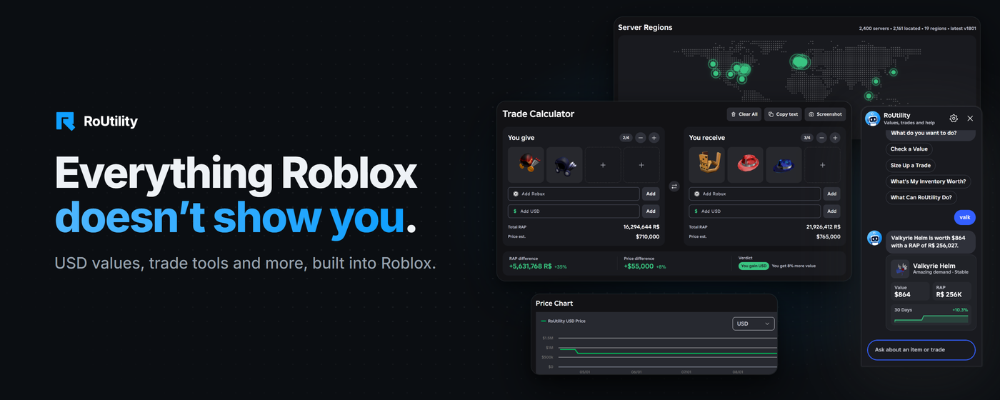
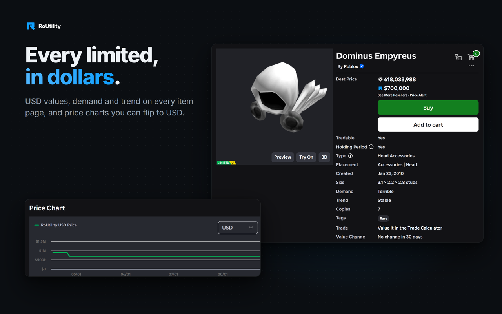
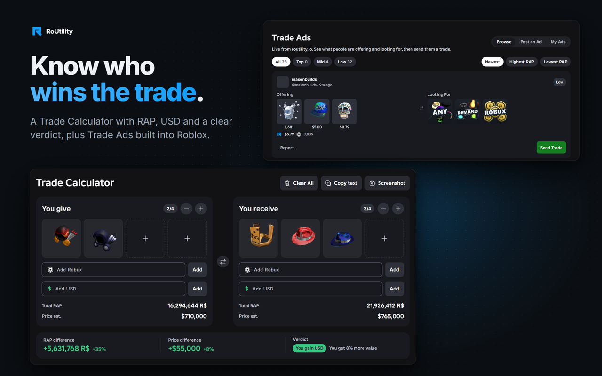
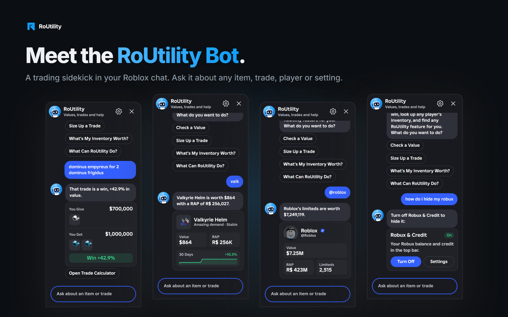
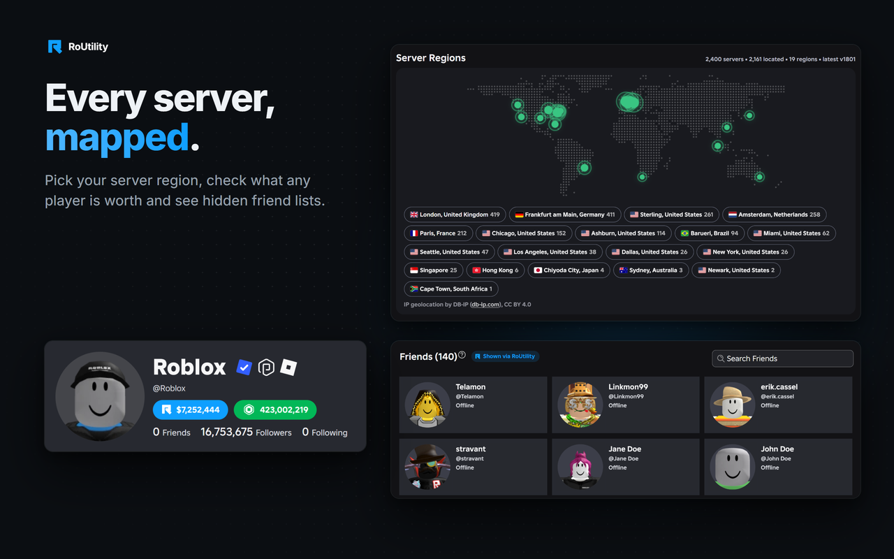
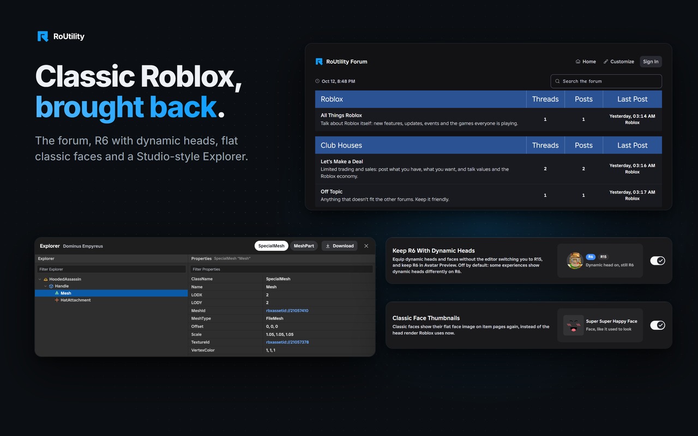

  

<h1 align="center">RoUtility</h1>

  USD values, trade tools and a lot of quality of life, built right into Roblox.
   
  <a href="https://chromewebstore.google.com/detail/routility/ecnkdocplhnoclmeenflmcempkmlmpia"><b>Chrome Web Store</b></a>
  &nbsp;·&nbsp;
  <a href="https://routility.io"><b>routility.io</b></a>

  
  
  

---

RoUtility adds the things Roblox doesn't show you to Roblox's own pages. There are no new tabs and no separate site to visit. Everything blends in with the native look, works in light and dark mode, and can be switched off one feature at a time in **Settings → RoUtility**.

## What it does

**Items and Marketplace**
- USD value, RAP, demand and trend on every limited
- Price history charts you can flip to USD, plus the best reseller deals
- Owners list with serials, which of your friends own an item, and when you got yours
- 3D try on preview and a Studio style Explorer for any model or accessory

**Trading**
- Values and a win or loss verdict on every offer
- Trade Calculator with saved trades
- Trade Ads, filters by item or player, and a one click cleanup for old trades

**Profiles, Friends and Inventory**
- Profile value and RAP, plus inventory search and sorting
- Mutual friends, friend filters and friend lists Roblox hides
- Friend request filters by badges, mutuals, followers and join date
- Friend History, a page of who was added to your friends list and who is no longer on it

**Experiences and Communities**
- Server regions with a preferred region, and exact visit counts
- Friends in a community, exact members and funds

**Creator Hub**
- Script Scan flags backdoors in Creator Store models before you insert them
- Experience and place ids, quick links and Robux to USD

**And more**
- A community forum built into Roblox
- Desktop notifications for new trades and new limiteds
- Playtime tracking, an outfit rotator, badge cleanup and dozens of small fixes

## Screenshots

  
  
  
  

  

## Install

The easiest way is the [Chrome Web Store](https://chromewebstore.google.com/detail/routility/ecnkdocplhnoclmeenflmcempkmlmpia). It updates on its own.

To run it from this repo instead:

1. Download or clone this repository
2. Open `chrome://extensions` and turn on **Developer mode**
3. Click **Load unpacked** and pick the folder with `manifest.json` in it
4. Open [roblox.com](https://www.roblox.com) and you're set

It works in Chrome, Edge, Brave, Opera and other Chromium browsers. There is no build step. The files here are exactly what the browser runs.

## How it works

If you want to build your own Roblox extension, this is a quick tour of how RoUtility is put together.

**Content scripts** do almost everything. They run on roblox.com in Chrome's isolated world, watch the page with a `MutationObserver`, and add RoUtility's pieces into Roblox's own elements. The page is never replaced. New UI reuses Roblox's CSS classes, so it looks native and follows the theme automatically. `src/core/ui.js` holds the shared helpers (building elements, prices, tooltips, friend lists, inventories) and loads first.

**Page scripts** are the `*-main.js` files, kept next to the feature they belong to. They run in the page's own world so they can see Roblox's own network responses, for example the inventory list or the server list, and pass the useful bits back to the content scripts with `postMessage`.

**The background service worker** (`src/background/background.js`) fetches item values from routility.io, sends desktop notifications, runs scheduled jobs like the playtime counter, and answers requests from the content scripts.

**Calls to Roblox** go straight from your browser to Roblox's public web APIs, the same ones roblox.com itself uses. Your Roblox cookie and password are never read or sent anywhere.

**Translations** live in `locales/` (16 languages). UI text goes through small `lt()` helpers from `src/core/i18n.js`.

| Path | What's inside |
| --- | --- |
| `manifest.json` | Permissions, which script runs on which page, and load order |
| `src/background/` | Service worker: values, notifications, alarms, context menu |
| `src/core/` | Shared pieces every script uses: `ui.js` helpers, `i18n.js`, `net.js`, and `content.js`, the router that turns features on for the page you're on |
| `src/features/` | One folder per area (profile, trading, avatar, items, friends, games…), with any `*-main.js` page scripts it needs |
| `src/settings/` | The RoUtility tab inside Roblox Settings |
| `src/create/` | Creator Hub extras |
| `src/preview/` | 3D try on preview |
| `styles/` | Stylesheets |
| `assets/` | Icons and flags |
| `vendor/` | three.js and the Draco decoder |
| `locales/`, `_locales/` | Translations |
| `rules/` | Declarative network rules (one header for server regions, page redirects) |

## Privacy

RoUtility only talks to Roblox and to routility.io, which serves item values, server regions, the forum and trade ads. Nothing is sold and there are no ads or trackers. Most settings and history never leave your browser. The full policy is on [routility.io](https://routility.io).

## What's new

See [CHANGELOG.md](CHANGELOG.md) for every update, what changed and who helped. The same log is inside the extension under Settings > RoUtility > What's New.

## Contributing

Found a bug or have an idea? Open an issue. Pull requests are welcome too. Please keep changes in the same style as the code around them, and test them on a few real pages first.

## License

RoUtility is released under the [MIT License](LICENSE). three.js and the Draco decoder keep their own licenses, listed in [THIRD_PARTY_NOTICES.txt](THIRD_PARTY_NOTICES.txt).

RoUtility is not affiliated with, endorsed by or sponsored by Roblox Corporation. Roblox is a trademark of Roblox Corporation.
